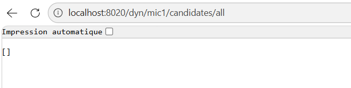
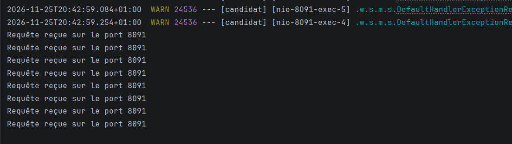
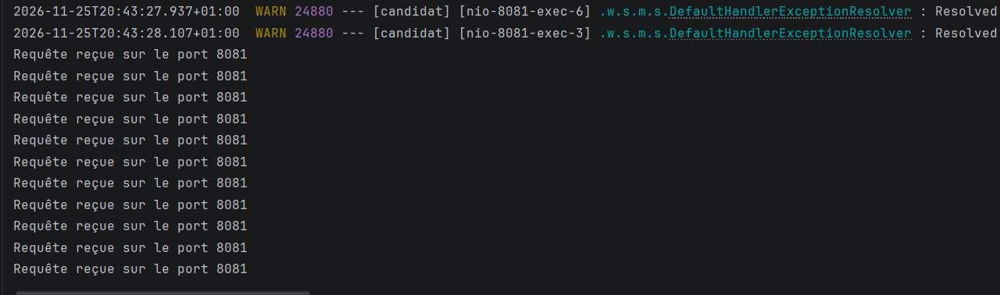
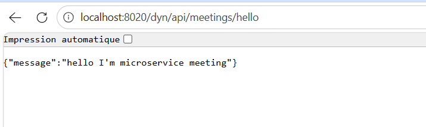
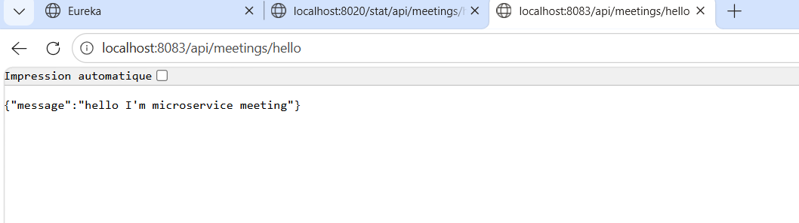
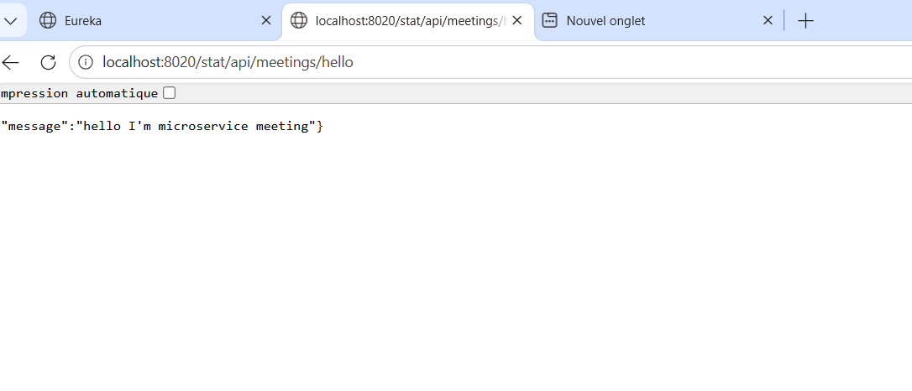

# Atelier API Gateway - Spring Cloud (WebMVC)

Ce projet implémente une API Gateway servant de point d'entrée unique pour nos microservices. Il illustre deux modes de configuration : le routage **statique** (URI fixe) et le routage **dynamique** via **Eureka**.

## 1. Architecture du projet

La Gateway tourne sur le port `8020` et communique avec les microservices suivants :

| Microservice | Nom Eureka | Port | Endpoint de test |
| :--- | :--- | :--- | :--- |
| **Candidat** | `CANDIDAT` | 8081 / 8091 | `/mic1/candidates/all` |
| **Meeting** (NestJS) | `MEETING` | 8083 | `/api/meetings/hello` |
| **Job** | `JOB` | 8082 | `/api/jobs/1` |

---

## 2. Validation de l'algorithme Random pour le service Candidat (Partie 3 - Q3)

Pour appliquer l'algorithme `RandomLoadBalancer` uniquement sur le service `CANDIDAT`, nous avons configuré une classe dédiée avec `@LoadBalancerClient`.

**Test avec deux instances (8081 et 8091) :**
*URL de test :* `http://localhost:8020/dyn/mic1/candidates/all`

*Figure 1 : Appel via la Gateway sur le service Candidat. La base de données étant vide, la réponse est un tableau vide `[]`.*

**Preuve de l'algorithme dans les logs :**

*Figure 2 : Capture d'écran de la console de l'instance 8091 du microservice CANDIDAT. On observe plusieurs requêtes consécutives reçues sur ce port.*

*Figure 3 : Capture d'écran de la console de l'instance 8081 du microservice CANDIDAT. On observe également plusieurs requêtes consécutives. L'absence d'alternance stricte (1 pour 8081, puis 1 pour 8091) entre les deux instances prouve que l'algorithme `RandomLoadBalancer` est bien actif pour ce service.*

---

## 3. Test de la Configuration Dynamique (Meeting)

Le routage dynamique utilise le protocole `lb://` (Load Balancer). La Gateway interroge Eureka pour trouver l'adresse IP et le port de l'instance disponible.

*URL de test :* `http://localhost:8020/dyn/api/meetings/hello`

*Figure 4 : Accès au microservice Meeting via la route dynamique (`lb://MEETING`). La Gateway a résolu le nom du service via Eureka pour rediriger la requête avec succès.*

---

## 4. Comparaison des modes de Routage (Meeting)

Pour illustrer la différence entre les deux approches, voici les captures d'écran des appels au microservice Meeting (port 8083).

**A. Test direct du microservice (sans Gateway) :**
*URL :* `http://localhost:8083/api/meetings/hello`

*Figure 5 : Appel direct au microservice Meeting sur son port 8083 (NestJS).*

**B. Test via la Gateway (Mode Statique) :**
*URL :* `http://localhost:8020/stat/api/meetings/hello`

*Figure 6 : Accès au microservice Meeting via la route statique de la Gateway (`/stat/...`). L'URL montre que la requête passe bien par le port de la Gateway (8020) mais cible une adresse fixe.*

---
*Rapport généré dans le cadre de l'atelier "API Gateway" - Année Universitaire 2025-2026.*