# Architecture Web Distribuée : Eureka Server et Observabilité

Projet réalisé dans le cadre du cours **Architecture Web Distribuée** (ESPRIT, année universitaire 2026-2027), en deux ateliers :

1. **Atelier 1 : Eureka Server** (découverte de services avec des microservices Spring Boot, Node.js et Python).
2. **Atelier 2 : Observabilité** (santé, informations et propagation de l'état des services vers Eureka).

## Équipe

**Équipe : Pionneer**

| Nom et prénom | 

| Missaoui Jasser| 
| Akrout Aziz | 
| Jbeli Yassmine |
| Selmi Raghed |

## Architecture

| Microservice | Technologie | Port | Nom dans Eureka |
|---|---|---|---|
| Discovery (Eureka Server) | Spring Boot | 8761 | n/a |
| Candidat | Spring Boot + H2 | 8081 (et 8091) | `CANDIDAT` |
| Job | Spring Boot + MySQL | 8082 | `JOB` |
| Meeting | Node.js / Express | 8083 (et 8093) | `MEETING` |
| Notification | Python / FastAPI | 8084 (et 8094) | `NOTIFICATION` |

---

# Atelier 1 : Eureka Server

**Capture 1.** Candidat (8081) et Job (8082) s'enregistrent dans Eureka et apparaissent en UP, avec une instance chacun.

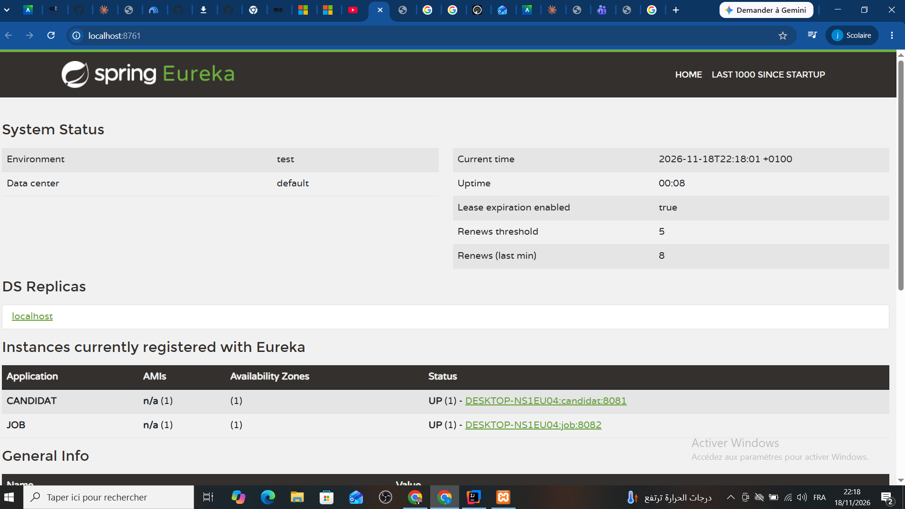

**Capture 2.** Une deuxième instance de Candidat lancée sur le port 8091 apparaît à côté de la première, et `CANDIDAT` passe à UP (2).

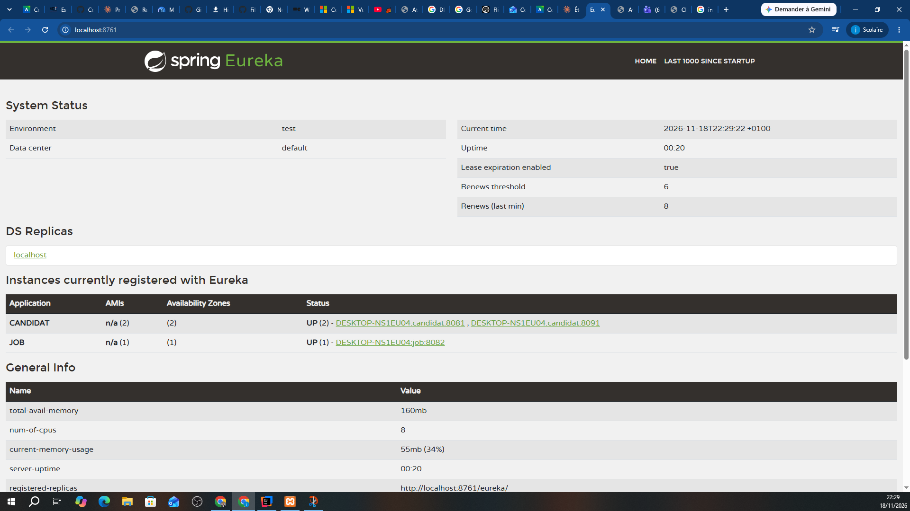

**Capture 3.** Meeting (Node.js) s'enregistre sous le nom `MEETING` avec deux instances, 8083 et 8093, en plus de Candidat et Job.

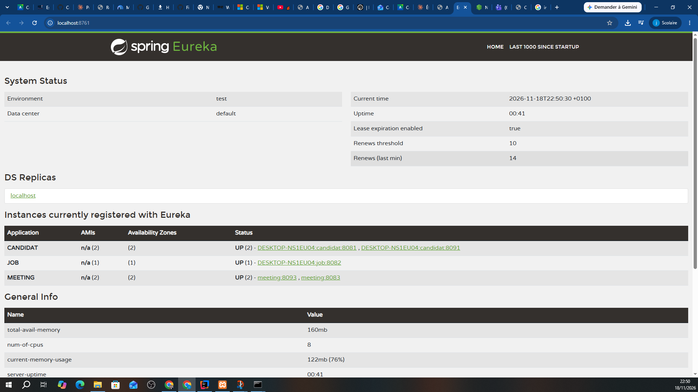

**Capture 4.** Les quatre services CANDIDAT, JOB, MEETING et NOTIFICATION sont visibles en même temps dans le dashboard, avec deux instances de CANDIDAT, MEETING et NOTIFICATION.

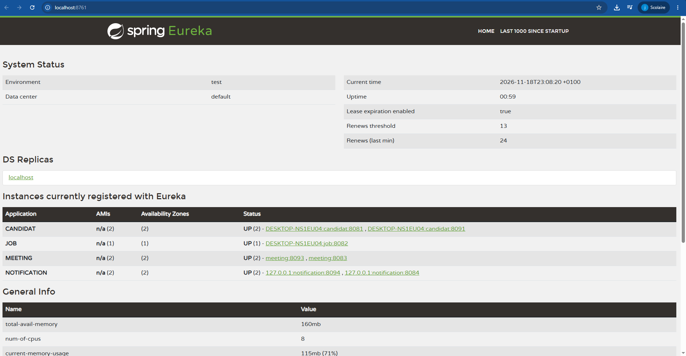

---

# Atelier 2 : Observabilité

## Spring Boot Actuator (Candidat et Job)

**Capture 5.** `/actuator/health` de Job renvoie le statut UP, avec le détail de la base MySQL, de la découverte Eureka (services et nombre d'instances) et de l'espace disque.

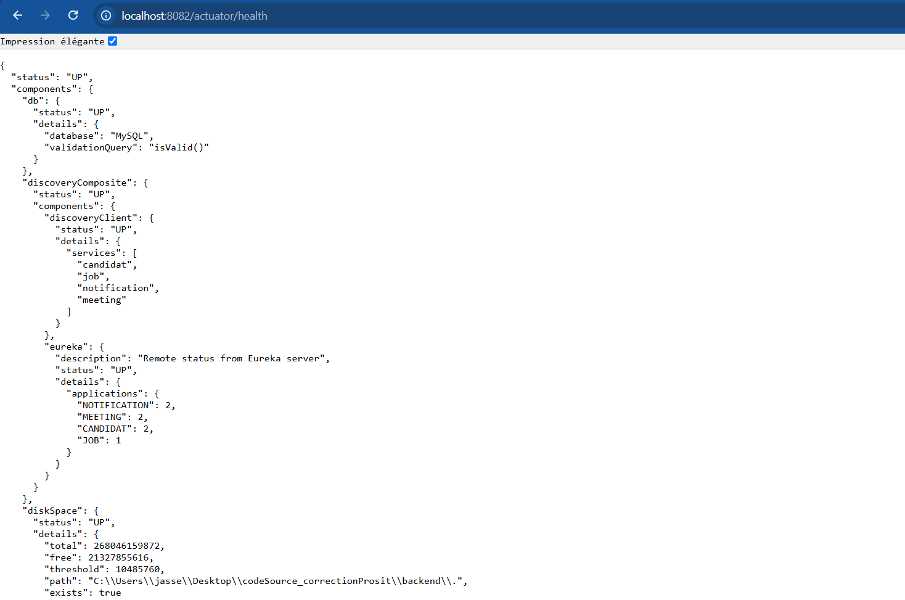

**Capture 6.** Lorsque la base MySQL est arrêtée, JOB passe en DOWN (en rouge) dans Eureka alors que les autres services restent UP, ce qui prouve que la santé d'Actuator remonte bien dans l'annuaire.

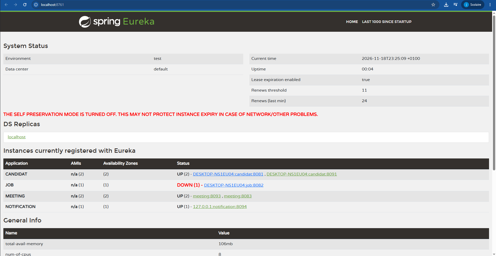

**Capture 7.** `/actuator/info` de Candidat renvoie le nom, la version, la description et le nom de l'équipe du service.

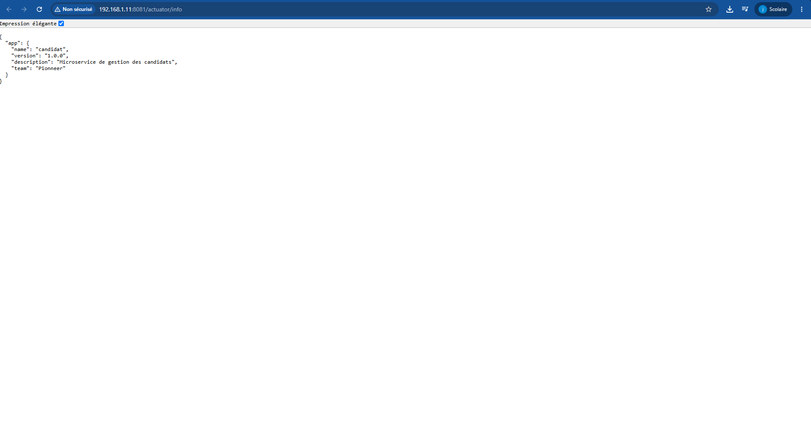

## Santé de Meeting (Node.js)

**Capture 8.** `GET /health` sur Meeting (port 8083) renvoie `{"status": "UP"}`.

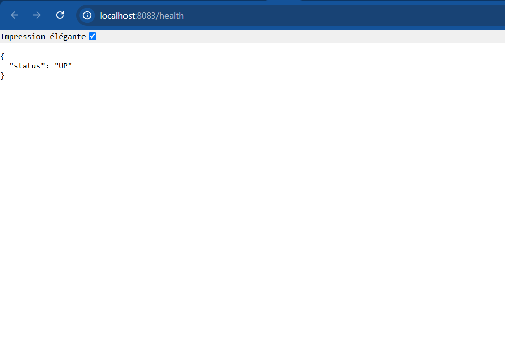

**Capture 9.** `GET /info` sur la deuxième instance de Meeting (port 8093) renvoie le nom, la version et la description du service.

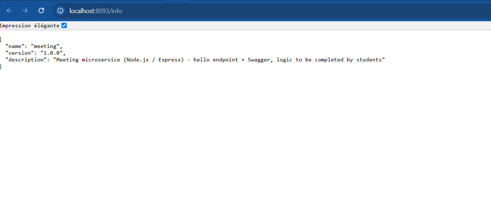

## Santé de Notification (Python)

**Capture 10.** `GET /health` sur Notification (port 8084) renvoie `{"status": "UP"}`.

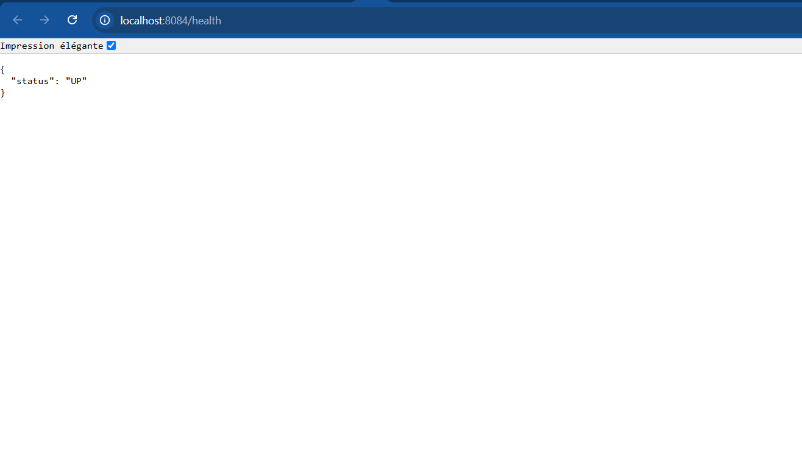

**Capture 11.** `GET /info` sur Notification renvoie son nom, sa version et sa description.

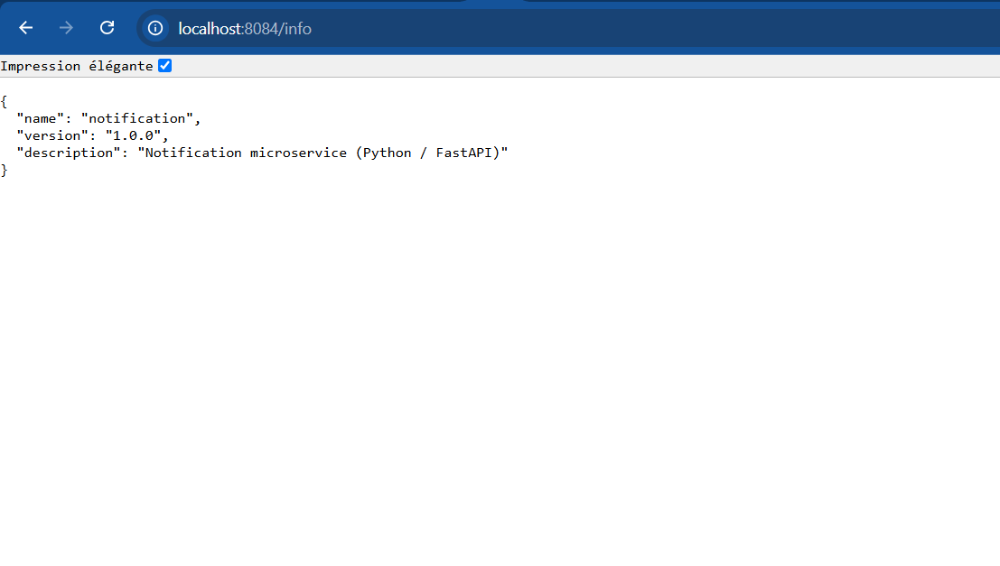

**Capture 12.** Le registre Eureka de `NOTIFICATION` contient bien les adresses `healthCheckUrl`, `statusPageUrl` et `homePageUrl` déclarées par l'instance.

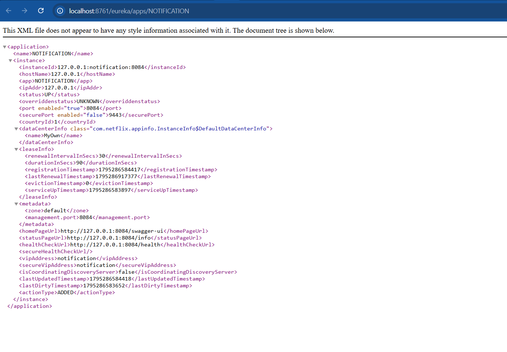
