# Architecture Web Distribuée : Eureka Server et Observabilité

Projet réalisé dans le cadre du cours **Architecture Web Distribuée** à ESPRIT, année universitaire 2026-2027.

Ce travail est organisé en deux ateliers :

1. **Atelier 1 : Eureka Server** — découverte de services avec des microservices Spring Boot, Node.js et Python.
2. **Atelier 2 : Observabilité** — surveillance de la santé, consultation des informations et propagation de l’état des services vers Eureka.

## Équipe

**Équipe : Pionneer**

- Jbeli Yassmine
- Akrout Aziz
- Selmi Raghed
- Jasser Missaoui

---

# Atelier 1 : Eureka Server

## 1. Démarrage des microservices et vérification de leur enregistrement dans Eureka

Nous avons démarré l’ensemble des microservices suivants :

- Candidat
- Candidature
- Job
- Meeting
- Notification

Nous avons ensuite ajouté une nouvelle instance des microservices **Candidat**, **Meeting** et **Notification**. Le tableau de bord Eureka permet de vérifier que toutes les instances sont bien enregistrées et affichées avec le statut `UP`.

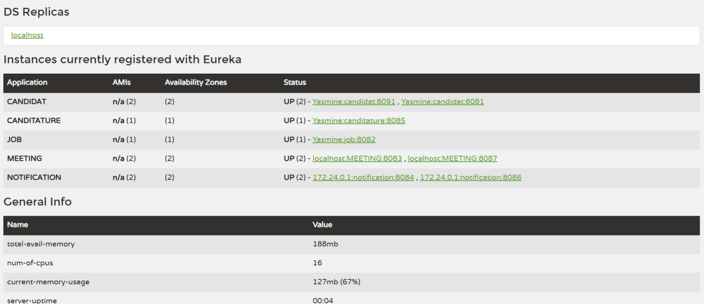

---

# Atelier 2 : Observabilité avec Spring Boot Actuator

## 2. Mise en place de Spring Boot Actuator

Spring Boot Actuator a été mis en place dans les microservices **Candidat**, **Candidature** et **Job**, à travers la dépendance et la configuration dans `application.properties`.

### 2.1 Ajout de la dépendance

La dépendance `spring-boot-starter-actuator` est ajoutée au fichier `pom.xml`.

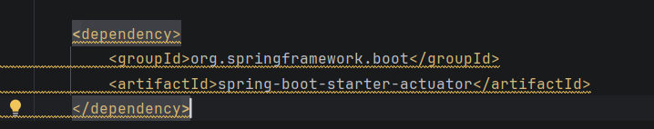

### 2.2 Configuration dans application.properties

Les endpoints Actuator sont exposés, les détails de santé sont configurés et le statut de santé est transmis à Eureka.

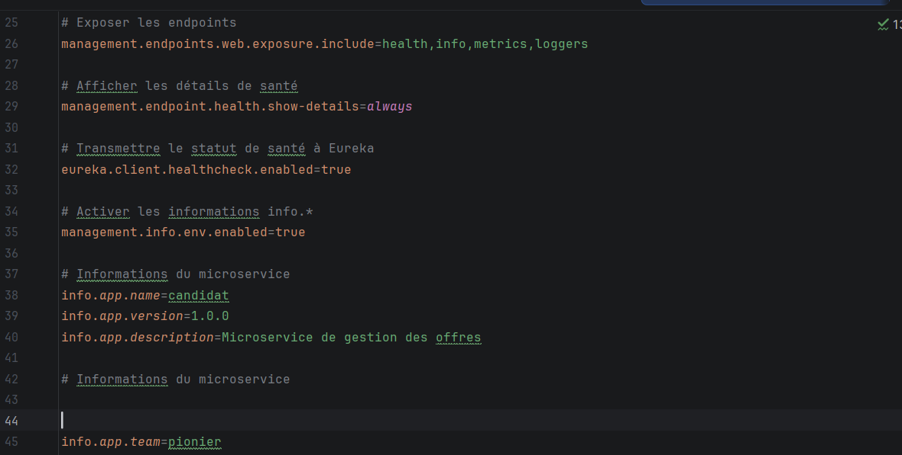

## 3. Vérification de l’état de santé du microservice Job

L’endpoint `/actuator/health` permet de vérifier l’état de santé du microservice Job.

| Élément vérifié | Résultat | Signification |
|---|---|---|
| `status` | `UP` | Microservice opérationnel |
| `db` | `UP` | Connexion à MySQL réussie |
| `discoveryComposite` | `UP` | Connexion à Eureka réussie |
| `diskSpace` | `UP` | Espace disque disponible |
| `ping` | `UP` | Vérification réussie |
| `refreshScope` | `UP` | Composant opérationnel |

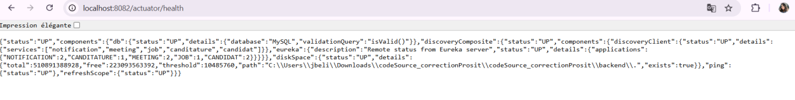

Dans `discoveryComposite`, nous observons les instances suivantes :

- NOTIFICATION : 2 instances
- MEETING : 2 instances
- JOB : 1 instance
- CANDIDAT : 2 instances
- CANDIDATURE : 1 instance

Cela confirme que Job récupère correctement les informations du registre Eureka.

## 4. Simulation d’une panne de la base de données

Une panne de la base de données a été provoquée afin d’observer son effet sur l’état de santé et sur le tableau de bord Eureka.

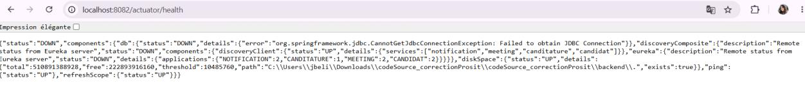

## 5. Consultation de l’endpoint /actuator/info

L’endpoint `/actuator/info` permet de consulter les informations descriptives configurées pour le microservice Candidat.

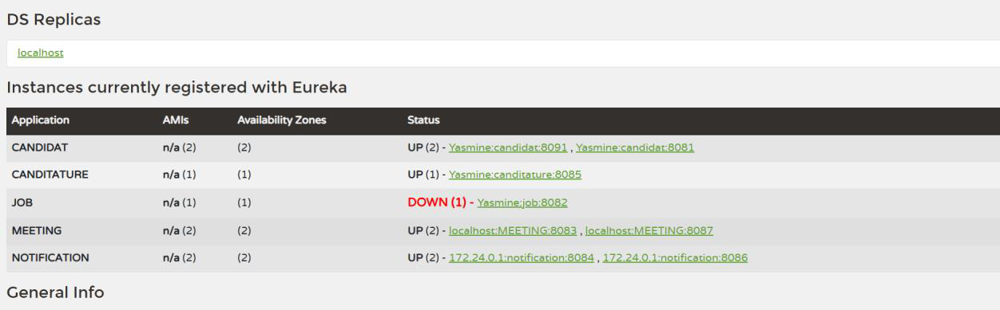

## 6. Consultation des métriques du microservice Candidat

L’endpoint suivant permet d’obtenir la liste des métriques disponibles :

`http://localhost:8081/actuator/metrics`

Nous avons consulté les indicateurs permettant de surveiller les performances et les ressources utilisées par le microservice Candidat.

| Métrique | Signification |
|---|---|
| `jvm.memory.used` | Mémoire utilisée par la JVM |
| `jvm.memory.max` | Mémoire maximale disponible |
| `process.cpu.usage` | Utilisation du processeur par le processus |
| `http.server.requests` | Nombre et durée des requêtes HTTP |
| `jdbc.connections.active` | Nombre de connexions actives à la base de données |
| `system.cpu.count` | Nombre de processeurs disponibles |

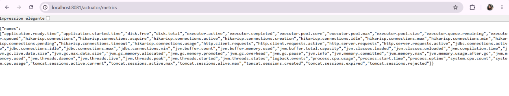

### 6.1 Mémoire utilisée

Endpoint consulté :

`http://localhost:8081/actuator/metrics/jvm.memory.used`

La mémoire utilisée affichée dans le résultat est de **182,72 MiB**, soit environ **191,7 millions d’octets**.

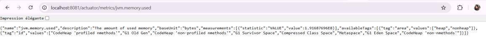

### 6.2 Requêtes HTTP

Endpoint consulté :

`http://localhost:8081/actuator/metrics/http.server.requests`

| Mesure | Valeur | Signification |
|---|---:|---|
| `COUNT` | 8 | 8 requêtes HTTP enregistrées |
| `TOTAL_TIME` | 0,299 s | Durée cumulée des requêtes |
| `MAX` | 0,069 s | Durée maximale d’une requête |

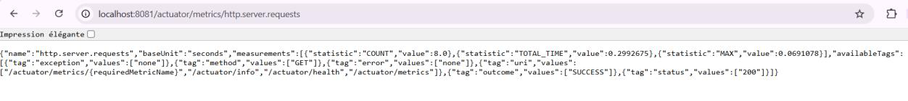

## 7. Filtrage des métriques HTTP selon le code de réponse 200

Une requête a été exécutée depuis l’API, puis les métriques ont été filtrées selon le statut `200`.

| Mesure | Valeur | Signification |
|---|---:|---|
| `COUNT` | 16 | 16 requêtes avec le statut 200 |
| `TOTAL_TIME` | 4,105 s | Durée cumulée de ces requêtes |
| `MAX` | 3,379 s | Durée maximale d’une requête |

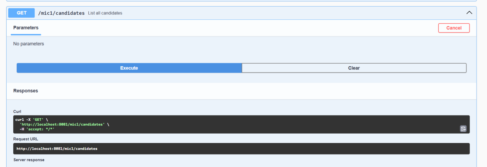

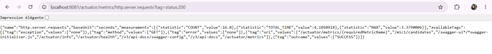

**Constats :**

- Toutes les requêtes mesurées dans ce résultat ont le statut 200.
- Aucune exception n’a été enregistrée (`exception: none`).
- Le filtre permet d’analyser uniquement les requêtes réussies.

## 8. Gestion des logs avec /actuator/loggers

L’endpoint suivant permet de consulter les niveaux de journalisation :

`http://localhost:8081/actuator/loggers`

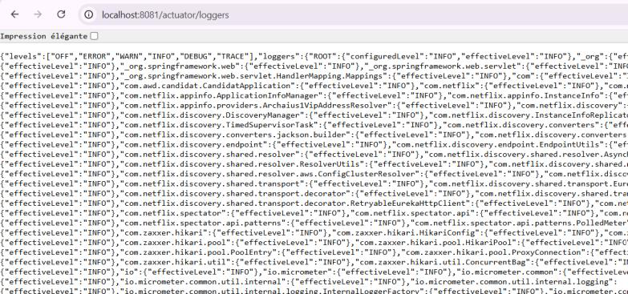

### 8.1 Consulter le logger ROOT

Endpoint consulté :

`http://localhost:8081/actuator/loggers/ROOT`

Le résultat indique que le niveau configuré et le niveau effectif sont `INFO`.

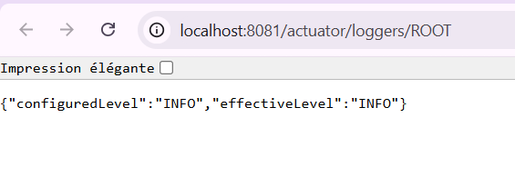

### 8.2 Modifier le niveau de journalisation

Le niveau du logger ROOT a été modifié en `DEBUG` à l’aide d’une requête POST.

Commande utilisée dans PowerShell :

```powershell
Invoke-RestMethod -Method POST `
  -Uri "http://localhost:8081/actuator/loggers/ROOT" `
  -ContentType "application/json" `
  -Body '{"configuredLevel":"DEBUG"}'
```

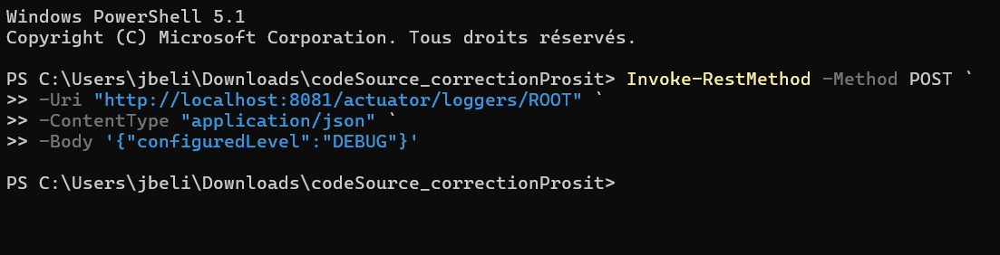

Le résultat de la consultation confirme le niveau `DEBUG`.

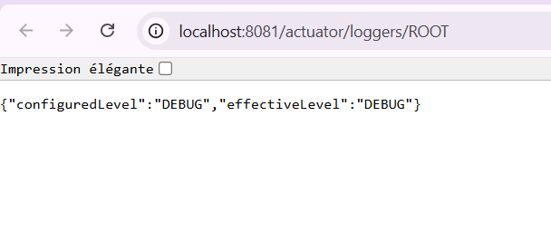

### 8.3 Restaurer le niveau INFO

Le niveau de journalisation a ensuite été restauré à `INFO`.

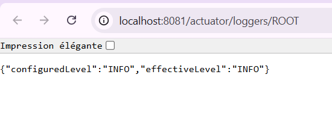

---

## Documentation originale

Le PDF complet contenant la présentation, les étapes et les captures d’écran est disponible ici :

[Consulter la documentation originale (PDF)](docs/Documentation-complete-originale.pdf)
